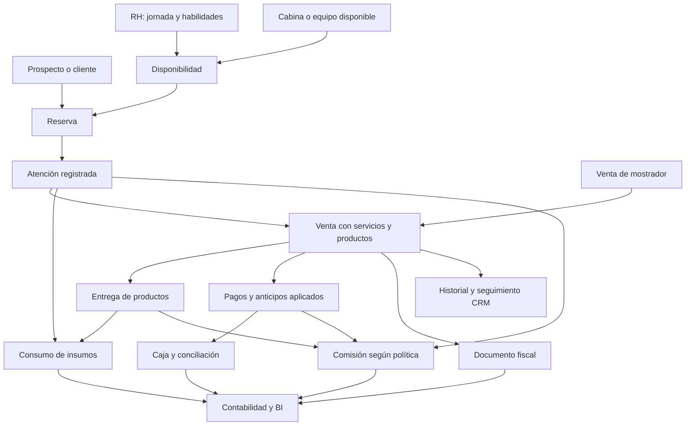
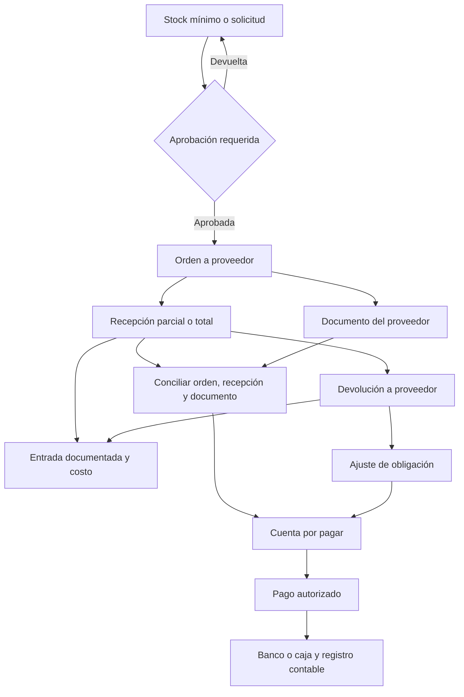
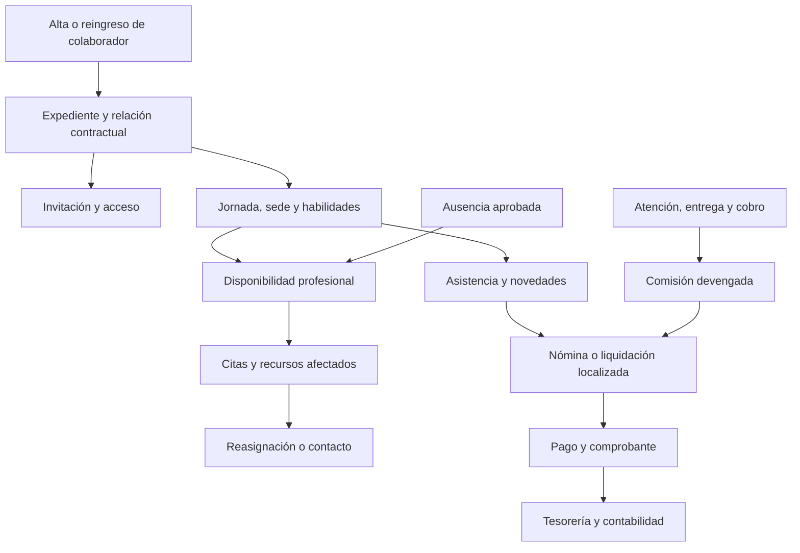
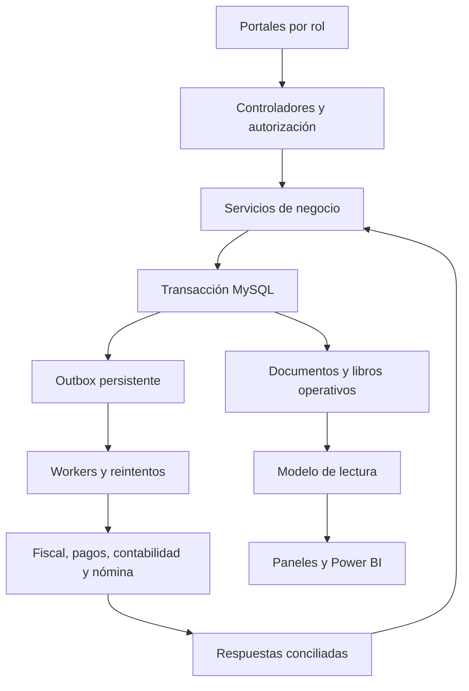

# AppSalon: auditoría comparativa y plan maestro de gestión del negocio

Fecha de consulta: 17 de octubre de 2026, America/Guayaquil.

Decisión posterior vigente (18 de octubre de 2026, America/Guayaquil): el usuario solicita un sistema propio de facturación. Se implementarán también contabilidad y nómina como dominios propios, con conexión directa al SRI para la fiscalidad ecuatoriana. Las recomendaciones de tercerizar esos motores que aparecen en la auditoría original quedan sustituidas por esta decisión. Banca, adquisición de tarjetas, certificado del emisor y servicios estatales conservan sus respectivas conexiones externas; no se simulará autorización fiscal ni movimiento bancario.

## 1. Resultado y alcance

La evolución recomendada es una plataforma integrada para un negocio de servicios de belleza con venta de productos: operación especializada de salón, CRM, PDV, facturación, inventario, compras, finanzas, RH, aprobaciones, documentos y BI. Estos bloques comparten identidades, documentos y eventos; no deben convertirse en aplicaciones con registros duplicados.

Se recomienda desarrollar en AppSalon los procesos que diferencian al salón y preparar integraciones para facturación, contabilidad y nómina regulada. El propietario puede trabajar desde un portal común aunque esos procesos tengan un motor externo. La elección de proveedores queda pendiente: esta comparación no contrata servicios ni supone disponibilidad local de todas las funciones anunciadas.

La auditoría técnica se basa en `main` commit `530009e52561e2c0ee0363165bfd8bf246a9559b`, árbol `f58966872896c49a617c08725b0c12fef0e61c0a`. El documento complementario `AUDITORIA_PDV_Y_FILTROS_2026-10-17.md` contiene evidencia por archivo, detalle de filtros y una reproducción real de la discrepancia financiera del CRM. Este plan amplía su alcance a ERP/CRM/SGA/BPM/BI/HRIS. No aplica cambios funcionales.

Supuestos de diseño: negocio de salón/belleza con servicios y productos; Ecuador como hipótesis fiscal; primera puesta en marcha en una empresa y sede, con estructura preparada para ampliar sedes. País, empleador, sedes, contratos de personal, canales, volumen, presupuesto y proveedores deben validarse antes de comprometer fechas o habilitar integraciones reales.

Método: comparación documental de capacidades declaradas por los fabricantes, contrastada con código de AppSalon. No se hicieron pruebas de uso autenticadas de las plataformas comparadas, ni se verificaron todos sus planes comerciales. Las conclusiones de conveniencia son juicio de diseño para AppSalon, no un ranking universal ni una certificación de equivalencia.

## 2. Qué enseñan otras aplicaciones

| Referencia | Capacidad contrastada en fuente oficial | Práctica que proponemos trasladar | Límite de la comparación |
|---|---|---|---|
| Fresha [S1] | Ticket conjunto de servicios/productos, paquetes, membresías, anticipos/pagos parciales y comisiones | Un recorrido de venta integrado desde la reserva hasta el saldo y los beneficios | Medios y funciones varían por país; no se acredita facturación SRI por ofrecer un PDF |
| Phorest [S2] | PDV conectado con stock, equipo, comisiones y reportes | Seguimiento por producto, prestación y colaborador; venta y atención enlazadas | La página consultada corresponde a su oferta estadounidense; no prueba nómina o fiscalidad ecuatoriana |
| Odoo [S3, S4] | Suite modular comercial/operativa; documentación de localización ecuatoriana y funciones fiscales para PDV | Módulos por dominio y relación entre venta, inventario, contabilidad y documento fiscal | Validar edición, versión, módulos y condiciones de integración; la existencia de localización no garantiza por sí sola la configuración del negocio |
| SAP Business One [S5] | Finanzas, compras, inventario, ventas, CRM y analítica en una solución para pymes | Maestros compartidos y continuidad documental de compra/venta hasta pago y análisis | Las necesidades del salón requieren evaluación funcional y posibles extensiones; no se ensayó una implementación |
| Dynamics 365 Business Central [S6] | Finanzas, compras, ventas, inventario/almacén y conexión con Power BI | Separar venta, cobro, recepción, pago y contabilización; tableros por rol | El ecosistema puede requerir otras aplicaciones y localización; no se asume que una licencia cubra todo |
| Zoho One [S7] | Familia de aplicaciones de CRM, finanzas/inventario, RH y analítica | Experiencia conectada con responsabilidad clara de cada módulo y acceso por perfil | Una suite de aplicaciones necesita mapeos y sincronización; disponibilidad fiscal/nómina local por confirmar |
| HubSpot [S8] | Gestión de oportunidades, contactos, tareas y seguimiento comercial | CRM con responsables, próximos pasos y trazabilidad de conversión | Sus funciones comerciales no demuestran cubrir inventario, agenda de salón o contabilidad completa |
| Factorial [S9] | Expediente/documentos, turnos, asistencia, ausencias, incorporación y desarrollo | RH como dueño de la relación laboral y autoservicio del colaborador | No se concluye disponibilidad de cálculo de nómina ecuatoriana a partir del catálogo general |
| Camunda [S10] | Procesos BPMN con tareas humanas y ejecución mediante workers | Aprobaciones con responsable, plazo, decisión y seguimiento | Adoptar estas prácticas no obliga a instalar un motor BPMN en la primera versión |
| Power BI [S11] | Conexión, modelado, visualización y distribución de analítica | Tableros operativos dentro de AppSalon y modelo analítico separado para gerencia | BI consume datos controlados; no sustituye las transacciones ni corrige por sí solo una mala conciliación |

Oracle distingue CRM orientado al vínculo comercial y ERP a procesos internos, y explica la utilidad de conectarlos [S12]. En AppSalon ambos ámbitos deben compartir la persona y las transacciones que les corresponden. La agenda especializada sigue siendo un dominio propio; un CRM con calendario genérico no demuestra cubrir duración, profesional, descansos, recursos y consumos.

No se utilizaron precios ni se asignaron puntuaciones numéricas de calidad sin una prueba común. Para elegir una compra futura se requiere demostración con los escenarios de aceptación de la sección 17 y cotización local.

## 3. Qué bloques implementar y con qué profundidad

| Bloque | Decisión | Alcance necesario | Ampliación condicionada |
|---|---|---|---|
| ERP | Sí, centrado en servicios y retail | Ventas, compras, cuentas por cobrar/pagar, tesorería, centros de costo, activos y conexión contable | Contabilidad propia completa solo si se decide asumir mantenimiento funcional/regulatorio |
| CRM | Sí | Personas, prospectos, oportunidades pertinentes, citas, compras, comunicaciones consentidas, campañas y postventa | Embudos complejos B2B solo si se venden convenios/eventos o tratamientos de ciclo largo |
| PDV | Sí, crítico | Servicio/producto, carrito, impuestos, anticipos, pagos mixtos, cambio, devoluciones, caja y comprobantes | Venta offline después de resolver sincronización y riesgo de stock/cobro |
| Facturación | Sí, crítica para la puesta en marcha fiscal | Emisor/comprador, impuestos, documento autorizado, correcciones y conciliación | Retenciones u otros documentos según régimen y operaciones, sin implementarlos por suposición |
| Inventario | Sí | Venta e insumos, movimientos documentados, costos, conteos, reposición y proveedores | Lotes/vencimientos cuando haya artículos que lo requieran |
| SGA/WMS | Básico inicialmente | Sede, almacén/ubicación, recepción, entrega, transferencias y conteos | Picking, packing, expedición y oleadas si hay bodega/distribución/ecommerce con esa operación |
| BPM | Sí, integrado | Solicitudes, reglas de aprobación, segregación de funciones, plazos y auditoría | Diseñador visual y motor externo si hay muchos flujos cambiantes entre sistemas |
| BI | Sí | Indicadores operativos y modelo reconciliado; conexión de lectura para Power BI | Pronóstico/IA cuando haya historial confiable y uso concreto |
| HRIS | Sí | Expediente, contratos/documentos, jornada, ausencias, asistencia, habilidades y vínculo profesional | Reclutamiento masivo si el crecimiento lo exige |
| HCM | Progresivo | Formación, habilitaciones para servicios y evaluación pertinente | Sucesión, carrera compleja y competencias corporativas si aportan al negocio |
| Nómina | Integración o módulo localizado | Novedades aprobadas, comisiones, comprobantes de pago y conciliación | Motor propio solo tras definir régimen, cálculos y validación especializada |
| DMS/documentos | Sí, transversal | Versiones, vigencia, acceso, firma cuando corresponda y vínculo con el proceso | Gestor documental corporativo completo si el volumen lo justifica |
| Activos/mantenimiento | Básico | Equipos, responsable, ubicación y bloqueos por mantenimiento | Depreciación/gestión técnica avanzada mediante contabilidad o especialista |
| Producción/MRP | No es requisito actual | Recetas de consumo de insumos por servicio | Fabricación industrial solo si el negocio efectivamente produce bienes |
| Multiempresa/franquicias | Preparación de datos, activación posterior | Empresa/sede explícitas y separación de permisos | Intercompañía, consolidación o regalías cuando existan entidades legales/franquicias |

ERP, CRM y RH son dominios; BPM, documentos, seguridad y BI atraviesan varios dominios. Crear un menú con esas siglas no garantiza su integración.

## 4. Auditoría del estado actual

| Dominio | Evidencia disponible en AppSalon | Falta para la cobertura objetivo | Prioridad |
|---|---|---|---|
| Identidad | Usuarios, membresía de cliente, colaboradores, invitaciones y roles en servidor | Cliente sin login; contactos fiscales; varias capacidades por colaborador sin duplicarlo; alcance por sede | Fundacional |
| RH/profesionales | Vínculo, expediente básico, horarios y restricciones laborales | Acción directa de vínculo, reconciliar colaborador existente, contratos, asistencia, licencias y jornada laboral | Alta |
| Agenda | Reservas, profesional, habilidades/servicios, descansos, bloqueos, atención y regularización | Recursos físicos, varios ejecutores/fases, tiempo de preparación y efecto de ausencia aprobada | Alta según servicios |
| PDV | Caja por cita con anticipos y parciales | Venta/líneas independientes de cita, carrito, precios/impuestos/descuentos y venta de producto | Crítica para ampliar |
| Pagos/caja | Efectivo, transferencia verificada, devoluciones, idempotencia y simulador de pasarela | Terminales/turnos/arqueo, datáfono o pasarela real y conciliación por medio | Crítica |
| Facturación | Recibo interno inmutable con secuencia y hash | Documento fiscal, proveedor/firmado, autorización, correcciones y seguimiento | Crítica para uso fiscal |
| Inventario/SGA | SKU, stock/costo de referencia y movimientos manuales bloqueados | Precio comercial, origen documental, venta/consumo, compras/recepciones, ubicaciones, reservas y conteos | Alta |
| Compras | No se identificó dominio de proveedor/orden/recepción en esquema y rutas auditados | Solicitud, orden, recepción parcial, documento proveedor, vencimiento y pago | Alta |
| Finanzas/contabilidad | Ingresos/egresos y reportes de movimientos | CxC/CxP, bancos, centros de costo, presupuestos y contabilidad por partida doble o integración | Alta |
| Comisión/nómina | Tarifa por profesional y cobro; devengo/reversa/liquidación | Regla por línea y vigencia, beneficiarios, novedades y conexión con nómina | Alta |
| CRM | Clientes, ficha, visitas, segmentación, fidelidad, consentimiento y analítica | Prospectos, interacción/tarea, seguimiento, reclamo, origen/canal y conversión | Media/alta |
| Promoción/fidelidad | Puntos por citas y beneficio solicitado/entregado | Motor económico de cupón/promoción, paquetes y saldos/obligaciones | Alta tras ventas |
| BPM | Operaciones concretas con autorización; regularización y verificación | Bandeja común de solicitudes, etapas, plazo y aprobaciones delegables | Alta para controles |
| Documentos | Formularios/respuestas y recibos, evidencias de consentimiento | Expediente versionado por persona/proceso, vigencia y permisos de documento | Media/alta |
| BI | Reportes y exportaciones con varias fechas de negocio | Modelo dimensional de ventas/líneas/eventos/stock/jornada y diccionario de métricas | Alta para gestión |
| Operación técnica | Migraciones, respaldo/restauración, PHPUnit, QA y navegador en CI | Perfil productivo, observabilidad, gestión de integraciones, mínimos privilegios y prueba de recuperación operativa | Fundacional |

### Hallazgos que deben resolverse primero

1. **Devolución parcial no conciliada en CRM.** Reproducción real en base efímera: cobrar 20 USD y devolver 5 USD el mismo día deja 15 USD netos en Caja y 20 USD en gasto de CRM. `CrmRepository::eventosPagos` no incorpora el libro de devoluciones parciales. Es prioridad alta de integridad, no una falta cosmética.
2. **Vinculación heredada incompleta en navegación.** Profesionales muestra aviso sin CTA; RH sí enlaza la invitación con ID seleccionado. La invitación existente no sustituye un flujo de reconciliación con colaborador ya registrado.
3. **Filtro Estado de Agenda desalineado.** Fechas y select no reciben el mismo estilo. Patrón de filtros heterogéneo y sin atajos comunes; listados limitados pueden ocultar resultados.
4. **Cita como documento económico central.** Cobro y recibo exigen contexto de cita. No es una base suficiente para venta de mostrador, insumos y factura comercial.
5. **Permisos demasiado agrupados para recepción/cajero.** `finanzas.gestionar` concentra acciones que deben distinguir cobrar, devolver, verificar, configurar y liquidar.
6. **Jornada y agenda profesional no son la misma entidad.** Los horarios profesionales no prueban asistencia ni horas pagables. Una licencia de RH debe afectar disponibilidad, pero no borrar turnos ni sustituir el expediente.
7. **Comisión actual al cobrar.** Puede devengarse sobre anticipo antes de prestar el servicio; la política objetivo debe resolverlo antes de calcular pagos al equipo.
8. **Comprador, cliente, miembro y usuario no equivalen.** La venta requiere datos fiscales/comerciales, sin obligar a crear credenciales ni convertir al propietario en cliente por su rol.
9. **Finanzas no equivale a contabilidad.** El registro de ingresos/egresos no contiene por sí solo libro mayor, saldos por cuenta ni cierre contable.
10. **Configuración local no es despliegue productivo.** Compose admite root por defecto y montaje del proyecto; requiere perfil productivo con secretos obligatorios y permisos separados de migración.

No se atribuyen porcentajes de avance: contar pantallas no mide profundidad, calidad ni cobertura de reglas. El CI de `main` terminó correctamente; eso no cubre capacidades de negocio aún inexistentes ni elimina la discrepancia nueva identificada.

## 5. Módulos y navegación final

| Grupo visible | Vistas principales | Responsable operativo |
|---|---|---|
| Mi día | Agenda, tareas pendientes, alertas y caja asignada | Cada rol con su alcance |
| Clientes y ventas | Clientes, prospectos, seguimiento, cotizaciones, ventas y devoluciones | Recepción/comercial |
| Atención | Agenda día/semana/mes, visitas, fichas de servicio, profesionales, cabinas/equipos | Recepción/gerencia/profesional |
| Punto de venta | Nueva venta, tickets en espera, cobro, comprobantes y devolución autorizada | Cajero/recepción habilitada |
| Caja y tesorería | Apertura/cierre, movimientos, arqueos, transferencias y conciliación | Cajero/finanzas |
| Facturación | Pendientes, autorizados, rechazados, correcciones y documentos del comprador | Finanzas/facturación |
| Productos y almacén | Catálogo, existencias, movimientos, conteos, consumos y transferencias | Inventario |
| Compras | Proveedores, solicitudes, órdenes, recepciones y devoluciones proveedor | Compras/inventario/finanzas |
| Finanzas | CxC, CxP, gastos, presupuestos, centros de costo y enlace contable | Finanzas |
| Recursos Humanos | Directorio, expediente, relación contractual, jornada, asistencia, ausencias, habilidades y documentos | RH |
| Remuneración | Reglas de comisión, devengos, ajustes, liquidaciones y novedades de nómina | RH/finanzas con segregación |
| Marketing y fidelidad | Segmentos, campañas, promociones, cupones, paquetes, beneficios y postventa | Marketing |
| Aprobaciones | Bandeja propia, autorizaciones, solicitudes y vencidas | Aprobador correspondiente |
| Indicadores | Operación, ventas, margen, caja, clientes, stock y equipo | Gerencia/propietario |
| Configuración | Empresa/sede, impuestos, permisos, reglas, integraciones y auditoría | Administración autorizada |
| Mi portal | Perfil, turnos, asistencia, solicitudes, documentos y remuneración propia autorizada | Colaborador |
| Portal cliente | Reservas, historial, beneficios, documentos y solicitudes propias | Cliente |

Profesionales seguirá siendo una vista operativa de las personas de RH habilitadas para prestar servicios. Los indicadores y reportes no ocuparán todo el directorio de clientes; cada pantalla tendrá un propósito principal, filtros breves y acceso a detalle.

## 6. Datos maestros, propiedad y modelo conceptual

Cada dato tiene un responsable. Una integración transmite cambios y estados; no crea dos maestros editables del mismo saldo.

| Dato/objeto | Fuente operativa propuesta | Relación obligatoria |
|---|---|---|
| Empresa legal | Configuración validada | Moneda, emisor, país y configuración fiscal |
| Sede/almacén/caja | Configuración/operación | Toda transacción lleva contexto, aunque inicialmente haya uno |
| Persona/contacto | Identidad común y perfiles específicos | Cliente, colaborador, proveedor u otros vínculos sin crear identidades incompatibles |
| Cuenta y permisos | Seguridad | Opcional para comprador; accesos laborales se suspenden sin borrar persona |
| Relación laboral | RH o HCM elegido | Empleador, vigencia, sede, rol/capacidades e historial; no confundir empleado con contratista |
| Capacidad profesional | Atención, ligada a RH | Servicios/habilidades, tarifas y disponibilidad; gerente también puede prestar servicios si se habilita |
| Producto/servicio/precio | Catálogo comercial | Vendible/consumible, unidad, impuesto, vigencia y restricciones |
| Existencia | Libro de inventario | Producto, ubicación, origen, cantidad física y reserva |
| Venta y líneas | Comercial/PDV | Comprador, origen opcional, snapshots, impuestos/descuentos y responsables |
| Pago/devolución/aplicación | Tesorería | Movimiento y documento al que se aplica; referencia externa única |
| Documento fiscal | Motor fiscal elegido | Venta y snapshot del emisor/comprador; estado externo conciliado |
| Comisión/novedad | Remuneración | Línea, política histórica, beneficiario y estado |
| Asiento contable | Sistema contable elegido | Evento de origen único, cuentas y período; se confirma retorno del asiento |
| Nómina | Motor localizado elegido | Novedades aprobadas y liquidación; no sumar por segunda vez una comisión pagada fuera de nómina |
| Indicador | Capa analítica | Linaje a eventos/documentos, regla/versionado y permisos |

Para evolucionar sin reescribir todo: conservar IDs de usuarios, clientes, colaboradores, profesionales, citas, pagos y productos. Agregar referencias y tablas de correspondencia progresivamente. Una persona puede ser colaborador y comprador, pero la membresía comercial es explícita. Solo las personas con ese vínculo entran al directorio de clientes por defecto.

Separar relación laboral y perfil de acceso evita que cambiar a gerencia destruya la capacidad profesional. Versionar contratos/condiciones si hay reingresos; no sobrescribir la historia de una baja.

## 7. Flujo comercial y de atención

El diagrama muestra dependencias, no exige que facturar ocurra después del último cobro. El hito de emisión fiscal se define según el tipo de operación y régimen. Un anticipo puede existir antes de la atención. La comisión usa los hechos necesarios de atención, entrega y pago según su política; no nace tres veces por recibir tres eventos.

Secuencia verificable de una visita:

1. Recepción identifica al cliente sin crear duplicados; si es un prospecto, conserva origen/campaña y próximo paso.
2. La reserva comprueba sede, profesional habilitado, jornada/disponibilidad, habilidades, duración, descansos, recursos y tiempo de preparación/limpieza. Los recursos se comprueban también al confirmar, no solo en el calendario.
3. Un anticipo se recibe y aplica al documento/origen con su estado real. No se cuenta como atención realizada.
4. La visita registra llegada/inicio/fin, servicios efectivamente prestados, ejecutor y consumos reales. Cambio de servicio/precio requiere reglas y evidencia.
5. El PDV crea o reutiliza la venta correspondiente. Se añaden productos, impuestos, descuentos autorizados y anticipos existentes.
6. Entrega y cobro registran sus eventos una vez. Transferencia pendiente, crédito autorizado o pago mixto dejan estados precisos; no se fuerza todo a pagado para terminar la pantalla.
7. El documento fiscal sigue su proceso de emisión/autorización; incidencias quedan en bandeja. El recibo de caja conserva su función propia.
8. Comisión, fidelidad y seguimiento se calculan con reglas históricas. Una encuesta o recordatorio tiene propósito/canal/consentimiento válidos y no se envía por el mero hecho de crear un contacto.

Disponibilidad objetivo: intersección entre jornada habilitada, oferta de agenda, habilidades y recurso, menos ausencias, descansos, bloqueos y ocupaciones. Si hay varias etapas/ejecutores, cada asignación consume su recurso e intervalo. Un calendario publicado no prueba presencia laboral.

## 8. Flujo de compras, almacén y obligaciones

Una orden no es stock físico ni un pago. Una recepción registra cantidad y costo; una factura proveedor registra obligación; el pago reduce esa obligación. Soportar entregas/facturas/pagos parciales y diferencia autorizada; no exigir que todo coincida en fecha o número de documentos.

Inventario distingue stock físico, reservado, disponible y no vendible. Las transferencias tienen salida de origen y recepción de destino, con tránsito cuando corresponda; una entrega no puede crear existencia por llegar primero a la segunda sede. Conteos generan ajustes aprobados con motivo, no edición directa del saldo. Definir costo promedio u otro método validado antes de prometer margen exacto. Lotes y caducidad, si aplican, participan en recepción, reserva, consumo y devolución.

La receta de un servicio estima consumo; la ejecución confirma/ajusta el consumo real. Un insumo abierto se gestiona en unidades/conversiones explícitas. Un producto vendido y un insumo consumido no deben descontar dos veces la misma cantidad por la misma prestación.

## 9. Flujo de RH, disponibilidad y remuneración

Dar de alta al colaborador no obliga a crear agenda para recepción o finanzas. Habilitar atención exige capacidad/servicios y configuración válida. La invitación concede acceso al aceptarse; registrar un contrato y dar credenciales son hechos distintos.

Una ausencia aprobada impide nuevas reservas en ese intervalo y abre la gestión de citas afectadas. No se cancela ni reasigna automáticamente una visita confirmada sin política y trazabilidad. Los cambios se serializan frente a nuevas reservas.

Asistencia registra hechos y correcciones aprobadas; no se deduce de que haya citas. El contrato define qué novedades corresponden y su tratamiento; horarios comerciales no equivalen a horas remunerables. Empleados y prestadores externos pueden requerir liquidaciones distintas. La comisión conserva beneficiario, línea, base, tarifa y vigencia incluso tras baja o cambio de rol.

Para servicios se propone comisión ganada tras prestación y cobro verificado, con anticipo provisional; para productos, tras entrega y cobro. Es una política propuesta que requiere validación comercial. Para cada comisión se define una sola vía de pago: nómina o liquidación directa. Reversas posteriores se compensan con ajuste; nunca se reescribe una nómina/liquidación cerrada.

Formación, evaluaciones y habilitaciones se incorporan progresivamente; una certificación vencida puede impedir ofrecer un servicio solo si así se define. Reclutamiento y carrera corporativa se posponen salvo necesidad acreditada.

## 10. Flujo de devoluciones y correcciones

La devolución tiene tres dimensiones: restitución comercial, movimiento físico y dinero. Una cuarta dimensión aparece si requiere corrección fiscal. Cada una conserva estado propio y el expediente muestra el conjunto.

| Caso | Acción comercial | Stock | Dinero/comisión/documento |
|---|---|---|---|
| Cancelación con anticipo | Cancelar prestación según política | Liberar reserva no entregada | Devolver o aplicar saldo con autorización; no inventar servicio realizado |
| Producto sin usar | Devolver línea/cantidad original | Reingresar si inspección permite vender | Devolver precio neto original; reversar comisión y emitir corrección fiscal aplicable |
| Producto abierto/dañado | Registrar motivo y resolución | No vendible o merma; no disponible automáticamente | Devolución monetaria según autorización y corrección relacionada |
| Servicio disconforme | Reclamo y resolución | Insumo consumido permanece consumido | Compensación/devolución/represtación con costo y autorización; no borrar atención |
| Cupón o paquete utilizado | Aplicar regla histórica de reversa | Según bienes entregados | No recalcular devolución usando promoción de hoy; ajustar saldo/derechos según política |
| Cobro confirmado, proveedor sin respuesta | Incidencia y conciliación | Conservar estado de entrega | Consultar referencia externa antes de repetir cobro o devolución |

Prorratear descuento y devoluciones en enteros; el acumulado devuelto no supera cantidad/importe permitido. Una nota de crédito no demuestra por sí sola que el dinero volvió al cliente. Una devolución de dinero tampoco restituye automáticamente stock o sesiones de un paquete.

## 11. Finanzas, fiscalidad y contabilidad

Separar ventas netas, cobros, anticipos, impuestos, gastos, costo y obligaciones. La caja física cuenta efectivo; transferencias/datáfono tienen conciliación propia. Saldos a favor, paquetes prepagados, suscripciones y tarjetas regalo requieren libro de derechos/obligaciones; no se clasifican todos como servicio ya realizado.

Para el alcance ecuatoriano, confirmar emisor, régimen, establecimientos, impuestos y documentos aplicables antes del diseño fiscal definitivo. El SRI publica requisitos de firma/autorización y especificaciones técnicas [S13]. No se fija en este plan una tasa, cálculo laboral o plazo normativo sin validar el caso. Configuración fiscal con vigencia y snapshots evita alterar operaciones pasadas al cambiar una tasa.

Dos alternativas contables:

- **Integrada externa, recomendada como primer alcance:** AppSalon produce documentos/eventos y mapeo de cuentas/centro de costo; el motor contable devuelve referencia/estado. Conciliar eventos contra asientos aceptados y exponer pendientes/errores. Finanzas puede trabajar desde AppSalon con integración visible.
- **Contabilidad propia:** agregar plan de cuentas, períodos, diario/mayor, partidas balanceadas, ajustes, cierres, activos y estados financieros; validar tratamiento tributario y contable con responsables competentes. No llamar contabilidad completa al módulo de caja.

Los cobros reducen saldo por cobrar; un gasto libre y una factura de compra no deben reconocer el mismo costo dos veces. Nómina, comisiones y compras enlazan con obligación y pago. La rentabilidad por servicio necesita consumo/costo, descuentos, comisión y un criterio de distribución de gastos; mostrar margen de contribución separado de utilidad total.

## 12. CRM, marketing y servicio al cliente

Mantener la base de clientes separada del panel analítico y añadir interacciones, responsable, tareas y próximo contacto. Un prospecto puede reservar sin pasar por un embudo complejo. Reservar no convierte automáticamente una oportunidad en ingreso realizado; se conserva si ganó por cita, venta o convenio según definición.

Embudo sencillo propuesto para ventas consultivas: nuevo → contactado → evaluación/cotización → reserva/contratación → ganado/perdido. Para reservas directas, ir a agenda sin crear pasos artificiales. Cotizaciones versionadas tienen vigencia y aceptación; generan venta sin volver a escribir productos/precios en otra pantalla.

Postventa registra reclamo, responsable, plazo, solución y costo de compensación. Campañas guardan origen, público elegible y resultados atribuibles con una regla explícita. Consentimiento por canal/finalidad, revocación y registro de envío deben conectarse con el CRM. Contratar WhatsApp/correo requiere validar API/proveedor, consentimiento y condiciones vigentes; este plan no presupone conectores ya operativos.

Promociones/cupones se aplican en servidor con vigencia, canal, productos/servicios, mínimos, prioridad, acumulación, tope y usos. El operador ve por qué aplica o no aplica. Canje de fidelidad se convierte en derecho o descuento explícito sin cobrarlo dos veces. Membresía de cliente actual es un vínculo de registro; una suscripción recurrente comercial requiere contrato, ciclo, cobro y derechos separados.

## 13. BPM, documentos y control interno

No hace falta un diseñador BPM universal para el primer despliegue. Implementar expedientes de solicitud con tipo, objeto, actor, responsable, plazo, estado, decisión, motivo y política/versionado.

| Flujo | Quién solicita | Quién resuelve | Efecto tras aprobación |
|---|---|---|---|
| Descuento sobre límite | Cajero/comercial | Gerente/propietario según umbral | Autoriza el precio específico, no un permiso indefinido |
| Transferencia declarada | Cajero | Verificador diferente según regla | Registra dinero confirmado y aplicaciones |
| Compra/gasto | Área solicitante | Aprobador presupuestario | Permite orden o pago conforme a lo aprobado |
| Ajuste/merma | Inventario | Supervisor habilitado | Anexa movimiento y evidencia |
| Ausencia/corrección asistencia | Colaborador/RH | Responsable habilitado | Actualiza disponibilidad/novedades y gestiona conflictos |
| Devolución excepcional | Recepción/cajero | Supervisor/finanzas | Autoriza importe, destino y corrección relacionada |
| Comisión/liquidación | RH/finanzas | Aprobador autorizado | Cierra lote y habilita pago, sin duplicarlo |
| Corrección fiscal | Facturación | Rol autorizado | Tramita documento relacionado conservando origen |

Evitar autoaprobación en operaciones sensibles salvo excepción explícita por estructura de empresa. Delegación tiene vigencia, alcance y auditoría. Solicitudes vencidas generan alerta/escalamiento; nunca pasan a aprobadas por timeout.

Documentos: expediente de colaborador, contratos, constancias, formularios de servicio, evidencias, compras y fiscales con versión, fecha, vigencia, autor, acceso y vínculo al objeto. Distinguir autorización comercial, consentimiento de datos y consentimiento informado del servicio. Fotos y datos sensibles requieren finalidad y acceso mínimo; no llevarlos a los reportes comerciales de todo el equipo. Firma/retención documental se decide según el documento y legislación aplicable.

## 14. BI y definiciones de indicadores

Dado que Jonathan ya trabaja con Power BI, resulta práctico publicar un modelo de lectura reconciliado y conservar en AppSalon los indicadores de acción diaria. Power BI ofrece conexión, modelado, informes y distribución controlada [S11]. Elegir Import/actualización incremental u otra modalidad tras medir volumen y latencia; no prometer tiempo real antes de medirlo.

| Indicador | Definición de negocio | Grano/fecha principal |
|---|---|---|
| Venta neta | Líneas comerciales netas de descuentos/devoluciones según política; impuestos separados | Línea de venta y fecha comercial |
| Cobro neto | Dinero confirmado menos dinero devuelto; simulaciones excluidas | Evento monetario y fecha real |
| Saldo por cobrar | Importe exigible menos aplicaciones válidas y ajustes | Documento/cliente al corte |
| Servicio realizado | Prestaciones completadas según fecha efectiva | Línea/atención y ejecutor |
| Ocupación | Minutos de recurso prestados o reservados / minutos disponibles; mostrar ambas métricas | Recurso, profesional, sede y día |
| No asistencia/cancelación | Eventos y motivo sobre universo de reservas definido | Cita; fecha programada y fecha de evento diferenciadas |
| Ticket | Ventas netas / documentos de venta válidos, con universo explícito | Venta; no confundir con promedio por abono |
| Margen de contribución | Venta neta sin impuesto − costo de bienes/insumos − comisiones según política | Línea de venta y costo congelado |
| Retención/recompra | Cohorte que vuelve en ventana definida | Cliente con fecha de primera compra/visita |
| Stock y rotación | Existencia/costo al corte y salidas según uso; merma visible | Producto, lote/ubicación cuando existan |
| RH | Ausencia, puntualidad y capacitación con definición autorizada | Jornada/colaborador; separar horas asistidas de minutos con citas |
| Conciliación | Diferencias entre venta, cobro, fiscal, stock y contabilidad | Evento/documento y fecha de conciliación |

Modelo propuesto: hechos de líneas de venta, atención, pagos, devoluciones, movimientos de stock, jornadas/asistencia y comisiones. Dimensiones de fecha con roles distintos, cliente, colaborador, producto/servicio, sede, recurso, canal, promoción y medio de pago. Snapshots para saldos al corte cuando sean necesarios. IDs y relaciones evitan duplicar importes al cruzar pagos múltiples con líneas múltiples. Ocupación y caja no se suman con el mismo grano.

Publicar diccionario, responsables y controles de conciliación antes de distribuir dashboards. Acceso de solo lectura, mínimo privilegio y alcance por sede/rol; historial laboral y datos privados no se exponen junto a ventas.

## 15. Arquitectura y reglas transversales

Conservar PHP MVC y evolucionar a monolito modular: controladores delgados, servicios de aplicación, reglas de dominio, repositorios y contratos entre módulos. Tablas pueden compartir MySQL, pero cada dominio mantiene quién escribe su estado. Evitar que PDV ejecute directamente mutaciones privadas de RH o que marketing modifique saldo de caja.

Una solicitud válida confirma cambios internos y evento pendiente dentro de la misma transacción. La integración ocurre después, con identidad estable y deduplicación. Si el proveedor respondió pero se perdió la conexión, consultar la referencia antes de repetir. Reintento conserva el mismo identificador económico. Integraciones fallidas tienen bandeja, responsable y acción de reanudar/conciliar; no se esconden como operación completada.

Reglas que no pueden negociarse en implementación:

- Dinero exacto y cantidades/unidades explícitas; impuestos, precios, descuentos y comisiones congelados por operación.
- Idempotencia por acción/origen, además de restricciones únicas de negocio; un ticket de reserva no crea dos ventas por doble clic.
- Bloqueos SQL con orden global probado; asignación de recurso y descuento/reserva de stock consistentes ante concurrencia.
- Venta, atención, entrega, cobro, fiscal y contabilidad tienen estados propios. Historial conserva actor y motivo.
- Documentos cerrados se corrigen mediante eventos/documentos relacionados; no borrado o actualización silenciosa de importes históricos.
- Permisos por acción y ámbito (empresa/sede/propio). No confiar en empresa, rol, importe o profesional enviados por el navegador.
- Bajas laborales revocan acceso y gestionan operaciones pendientes, sin borrar beneficiario ni documentos.
- Filtros/paginación/exportación comparten el universo normalizado. Rango visible, atajos calendario y límite/truncado explícito; funciones sin JS y pruebas visuales.
- Seguridad de sesión/CSRF y saneamiento existentes se conservan. Integraciones usan sus mecanismos de autenticación y validación de eventos.
- Configuración de secretos fuera del código; TLS, respaldo externo, restauración, retención y acceso auditado. Separar cuenta SQL de aplicación y migración.

Para varias empresas clientes (SaaS), la tenencia/aislamiento debe diseñarse antes de alojarlas; una columna de sede no ofrece aislamiento multiempresa. Si solo hay sucursales de la misma empresa, basta un alcance de sede coherente con cuentas y almacenes; no introducir multiempresa legal ficticia.

Operación offline de PDV es un proyecto propio: sincronización, identidad de documentos, cupón/stock, pagos, hora del dispositivo y conflictos. No anunciarla por almacenar un carrito en el navegador. Dejarla fuera del primer lanzamiento si no hay requisito.

## 16. Plan de implementación por dependencias

Las fases son entregas revisables, no meses prometidos. Cada fase incluye diseño, migración, permisos, pruebas, documentación, ensayo y validación operativa. Si se trabaja por iteraciones de dos semanas, su cantidad se estima al cerrar contratos funcionales y conocer capacidad del equipo.

| Fase | Entrega | Depende de | Evidencia para cerrar |
|---|---|---|---|
| F0. Consistencia existente | CTA RH, reconciliación de fichas, devolución parcial CRM, filtros y paginación | Código actual auditado | Caso 20−5 concilia en todas las vistas; ID/agenda conservados; filtros visuales/GET/exportación correctos |
| F1. Base empresarial | Empresa/sede, maestros, unidades, impuestos/precios con vigencia, permisos finos y contratos de módulos | F0 y decisiones mínimas | Matriz de permisos y datos, migración sin pérdida, incompatibilidades de empresa/sede rechazadas |
| F2. Comercial y venta | Venta/líneas, comprador sin cuenta, origen cita, cotización básica, anticipos y devoluciones comerciales | F1 | Servicio y producto en un documento; precios históricos y aplicaciones exactas; doble solicitud crea una venta |
| F3. Stock y abastecimiento | Venta/consumo documentados, reservas, conteos, proveedor/orden/recepción y CxP básica | F1/F2 | Sin sobreventa; recepciones parciales conciliadas; devoluciones/consumos no duplican stock |
| F4. Caja y pagos | Carrito/PDV usable, medios, caja/turnos/arqueo, devolución monetaria y conciliación | F2/F3 | Efectivo contado y bancos separados; timeout/reenvío seguro; anticipos no se cobran dos veces |
| F5. Fiscal y enlace contable | Motor fiscal de prueba, documentos/estados/correcciones, mapeo/eventos contables | F2/F4 y proveedor/emisor | Pruebas con proveedor/SRI según alcance, emisión sin duplicados, pendientes visibles y conciliación con asientos |
| F6. RH y remuneración | Jornada/asistencia/ausencias, recursos, habilidades, reglas de comisión y novedades de nómina | F1 y hechos de atención/venta/cobro | Ausencia/reserva concurrente controlada; una persona/beneficiario; abono directo o nómina sin doble pago |
| F7. CRM y crecimiento | Seguimientos/postventa, promociones/cupones, paquetes y fidelidad económica | F2–F5 y políticas definidas | Restricciones/uso concurrente y reversas correctos; campaña/consentimiento y resultados trazables |
| F8. Gestión y BI | CxC/CxP/tesorería completas, presupuestos, activos básicos, modelo Power BI, controles de cierre | Fuentes transaccionales estables | Totales conciliados entre venta, cobro, fiscal, stock, comisiones y contabilidad; glosario aprobado |
| F9. Piloto y ampliación | Piloto en sede/caja, formación, migración final y operación con soporte | F0–F8 para el alcance de lanzamiento | Ensayo de recuperación, aceptación por rol, conciliación de apertura/cierre y resolución de incidencias |

La base de RH ya existe: reconciliación y controles de estado no esperan a F6. BPM, auditoría y documentos se desarrollan con cada flujo desde F1; F6 amplía la profundidad de RH. BI operativo acompaña cada fase y F8 consolida el modelo gerencial. Impuestos/descuentos se modelan en F1/F2 aunque el administrador avanzado de promociones llegue en F7.

Puerta de lanzamiento: si el negocio necesita comprobante fiscal para sus ventas, el PDV no pasa a producción antes de F5 y la validación del emisor. Se puede demostrar y probar en entornos aislados antes. La validación temprana de proveedor y régimen se inicia durante F1 para no descubrir incompatibilidades al final.

### Paquetes de trabajo iniciales

| Paquete | Cambio concreto | Prueba de aceptación principal |
|---|---|---|
| F0-01 | CTA contextual y preservación de profesional heredado | Tarjeta → vínculo → RH conserva IDs, agenda, citas y comisiones |
| F0-02 | Reconciliación con colaborador existente | Rechaza identidad/vínculo ocupado y carrera concurrente; no crea persona duplicada |
| F0-03 | Una definición de evento monetario para CRM/Caja | Devolución parcial mismo mes y mes diferente, total y archivo coinciden |
| F0-04 | Componentes de campo/período | Fecha y select alineados; semana/mes/bisiesto y sin JS correctos |
| F0-05 | Paginación/conteo y retorno de filtros | Superar 500 citas no oculta resultados ni altera totales |
| F1-01 | Contrato de maestros/estados y claves de origen | Catálogos y relaciones con dueño único documentados |
| F1-02 | Permisos de cajero, verificador y supervisor | Cobrar no concede liquidar, ajustar stock o cambiar impuestos |
| F1-03 | Decisión fiscal/contable/nómina | Proveedor, país y casos reales validados; alcance explícito de integración |
| F1-04 | Modelo de migración y conciliación | Matriz de correspondencia y saldos iniciales reproducibles |
| F2-01 | Venta y líneas con snapshots | Cambio posterior de catálogo no altera ticket histórico |
| F2-02 | Aplicación de anticipos existentes | Reintento y retrocarga no crean nuevo dinero |
| F2-03 | Cotización/mostrador sin cita | Flujo completo sin cita ficticia y sin credenciales obligatorias |

No se paralelizan cambios que decidan a la vez el contrato de pago, la autoridad del stock o el significado de comisión. Tras fijar esos contratos, pantallas, adaptadores y pruebas pueden planificarse por entregas independientes.

## 17. Pruebas integrales y validación de aplicaciones externas

Los mismos casos sirven para evaluar un proveedor en demostración y para aceptar AppSalon. La disponibilidad se comprueba con configuración/país, no solo con una casilla comercial.

1. Crear colaborador, habilitar dos servicios y jornada; suspender y reactivar sin duplicar ficha ni perder citas. Vincular legado y rechazar conflicto.
2. Reservar profesional y cabina/equipo con restricciones simultáneas; dos operadores disputan el último intervalo. Ausencia aprobada obliga a gestionar visitas afectadas.
3. Registrar atención y consumo real diferente de receta, con motivo y costo; no descontar otra vez al cobrar.
4. Venta de servicio+producto, anticipo previo, descuento y pago mixto. Historial/stock/caja/fiscal/comisión concilian.
5. Venta solo de producto sin cita ni cuenta de cliente obligatoria; identificar comprador y obtener documento correspondiente.
6. Dos cajas venden la última unidad y usan el último cupón. Solo se confirma lo permitido; reintento tras timeout no duplica.
7. Cobrar 20, devolver 5 y después 3 en otro período. Neto, saldo, comisión, documento fiscal y movimientos son consistentes por fecha.
8. Recibir una compra en dos partes, facturar con diferencia autorizada y pagar parcialmente; obligación y stock no se duplican.
9. Abrir/cerrar caja con fondo, cambio, devolución, retiro y transferencia. Diferencia física registrada y conciliación por medio.
10. Paquete prepagado de sesiones: venta y cobro inicial, prestación parcial, saldo de sesiones y devolución según política; ingreso por cobro separado del realizado.
11. Colaborador deja de atender tras comisión devengada/liquidada; devolución posterior produce ajuste trazable sin cambiar su identidad.
12. Aprobación de descuento/gasto fuera de umbral; no autoaprobación por cambiar el rol enviado en el formulario.
13. Proveedor fiscal acepta y se pierde respuesta: consulta/reintento no emite otra factura. Rechazo visible, resolución y referencia a corrección.
14. Integración contable/nómina rechazada o duplicada; bandeja de conciliación y una sola obligación/asiento/pago.
15. Permisos por empresa/sede/propio, exportaciones, URL manipulada y revocación laboral durante operación; ni fugas de expediente ni saltos de autorización.
16. Filtros calendario, rangos, páginas, totales, chips y exportaciones equivalentes; capturas y geometría en móvil/tablet/escritorio.
17. Carga representativa de citas, ventas y movimientos; medir tiempos y bloqueos antes de fijar SLA de respuesta. Sin prometer capacidad no medida.
18. Migración de ensayo y recuperación completa con respaldos externos/documentos. Comparación de saldos e IDs, sin generar ventas fiscales retroactivas ni repetir movimientos.

QA combina pruebas de reglas, integración MySQL, concurrencia real, contratos de adaptador, HTTP/permisos y navegador. CI sobre el commit final, pruebas del proveedor en su ambiente y aceptación operativa son evidencias distintas. Las 1143 pruebas y 964 casos de QA del árbol auditado tienen solapamiento; no constituyen cobertura de los nuevos dominios.

## 18. Migración, despliegue y responsabilidades

Migración progresiva: inventario de datos → respaldo y copia aislada → diagnóstico/reconciliación → correspondencias → retrocarga marcada → comparación de saldos/documentos → ensayo por rol → piloto → corte. No fusionar identidades por nombre ni inventar identificación fiscal, correo, salario o contrato.

Los movimientos previos conservan origen/fecha/ID. Cargar una venta histórica no mueve stock, dinero o comisiones nuevamente. No convertir recibos internos en documentos autorizados ni emitir retroactivamente sin una operación fiscal expresa y válida. Diferencias de apertura requieren resolución documentada, no ajuste silencioso.

Durante transición, definir para cada operación cuál pantalla/servicio puede escribir. Deshabilitar el camino antiguo cuando el nuevo sea autoritativo; no mantener dos formas de cobrar que creen registros distintos. Usar migraciones aditivas y banderas por sede/función; cerrar compatibilidad solo tras conciliación.

Plan de retorno: antes de aceptar operaciones reales nuevas puede restaurarse el ensayo/corte según procedimiento. Después de registrar dinero/documentos reales, volver atrás no significa restaurar una base antigua perdiendo esas operaciones; aplicar contingencia operativa y correcciones hacia delante con conciliación. Backups de base incluyen manifiesto; documentos/certificados/configuración requieren su estrategia protegida y probada.

| Responsabilidad | Decisión/validación |
|---|---|
| Propietario/gerencia | Alcance, políticas comerciales, límites y aceptación del piloto |
| Recepción/caja | Recorrido real, tiempos de atención, cobro y arqueo |
| Profesional | Jornada de oferta, prestación, consumos y datos de servicio |
| Inventario/compras | Unidades, costos, recepción, conteos y proveedores |
| RH | Contratos, ausencias, acceso laboral y novedades |
| Finanzas/contador | Fiscalidad, mapeo contable, comisiones/nómina y conciliación |
| Desarrollo | Integridad, migración, permisos, adaptadores y observabilidad |
| QA/aceptación | Evidencia independiente, pruebas de escenarios y cierre de defectos |

Una persona puede cubrir varios roles en una empresa pequeña, pero el sistema conserva qué autorización ejerció y las excepciones aprobadas. No se promete segregación imposible sin definir responsables.

## 19. Construir, integrar o adoptar una suite

| Camino | Ventaja para este proyecto | Carga/riesgo | Cuándo elegirlo |
|---|---|---|---|
| Todo propio en AppSalon | Control de experiencia y reglas especializadas | Mantener contabilidad, nómina, fiscalidad y operación además del salón | Si hay equipo y presupuesto permanentes para esa responsabilidad |
| AppSalon especializado + motores integrados | Aprovecha lo construido y concentra desarrollo en operación; experiencia unificada posible | Requiere contratos, conciliación y gestión de proveedores | Recomendación inicial para la evolución solicitada |
| Adoptar suite y adaptar salón | Funcionalidad empresarial existente | Migración, licencias, ajustes de agenda y dependencia del ecosistema | Si gestión contable/empresarial pesa más que la experiencia especializada |

La decisión final requiere demostración de los casos de la sección 17, facturación/nómina local, API y exportación completa, soporte, costos de implementación/operación, continuidad y salida de datos. No basta comparar precio mensual. No se decide migrar AppSalon ni contratar un producto por esta auditoría.

## 20. Decisiones que fijan el alcance

Se puede comenzar la consistencia F0 con lo conocido. Antes de estimar el programa completo deben quedar resueltas:

- País, empresa/emisor, régimen, sedes, cajas y si habrá varias empresas o clientes SaaS.
- Solo salón o también estética clínica, venta online, distribución o fabricación; recursos físicos y tipos de servicios.
- Personal empleado/contratista, varios roles/capacidades, jornada/asistencia y reglas de comisión.
- Precios con/sin impuesto, promociones, crédito, paquetes, suscripciones, tarjetas regalo, propinas y saldos a favor.
- Productos vendibles/consumibles, unidades, almacenes, lotes/vencimientos y método de costo.
- Medios reales de pago, proveedor fiscal, sistema contable y nómina; APIs, contratos y ambiente de pruebas disponibles.
- Volúmenes, disponibilidad requerida, conectividad, retención, respaldo y recuperación; responsables de soporte.
- Qué estará listo en el primer lanzamiento y qué queda como ampliación; equipo/capacidad para estimar fechas.

## 21. Fuentes oficiales

Consulta documental 17/10/2026. Se describen capacidades publicadas; contratos, planes, versiones y localización deben confirmarse en una evaluación de compra. No se utilizaron videos o listados genéricos como evidencia técnica de una función.

- **S1. Fresha, PDV:** https://www.fresha.com/for-business/features/point-of-sale
- **S2. Phorest, PDV para salón:** https://www.phorest.com/us/features/salon-pos-software/
- **S3. Odoo, suite ERP:** https://www.odoo.com/erp y https://www.odoo.com/app/inventory
- **S4. Odoo, localización Ecuador 19:** https://www.odoo.com/documentation/19.0/applications/finance/fiscal_localizations/ecuador.html (información recuperada mediante índice de búsqueda oficial; la apertura directa devolvió error durante esta sesión).
- **S5. SAP Business One, cobertura:** https://www.sap.com/products/business-one.html?url_id=text-glo-404-b1-l1 y https://learning.sap.com/courses/managing-logistics-in-sap-business-one/introducing-sap-business-one
- **S6. Microsoft Dynamics 365 Business Central:** https://www.microsoft.com/en-us/dynamics-365/products/business-central
- **S7. Zoho One, aplicaciones:** https://www.zoho.com/one/applications/web.html
- **S8. HubSpot, productos:** https://www.hubspot.com/products?gad=1&tab=tab-crm
- **S9. Factorial, funciones:** https://factorial.com/features (redirección de https://factorialhr.com/features).
- **S10. Camunda, procesos:** https://docs.camunda.io/docs/components/concepts/processes/
- **S11. Microsoft, Power BI:** https://learn.microsoft.com/en-us/power-bi/fundamentals/power-bi-overview
- **S12. Oracle, ERP y CRM:** https://www.oracle.com/erp/erp-vs-crm/
- **S13. SRI, facturación electrónica:** https://www.sri.gob.ec/facturacion-electronica
